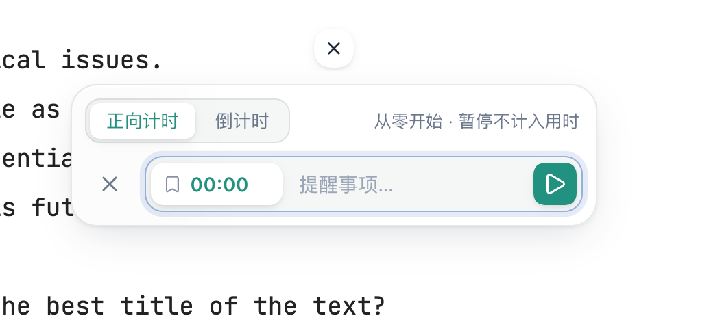
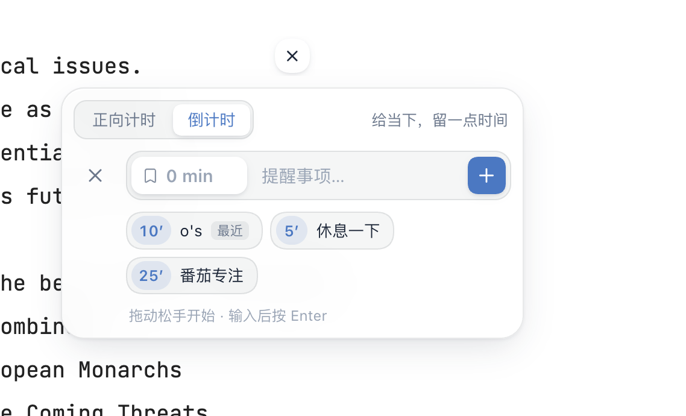
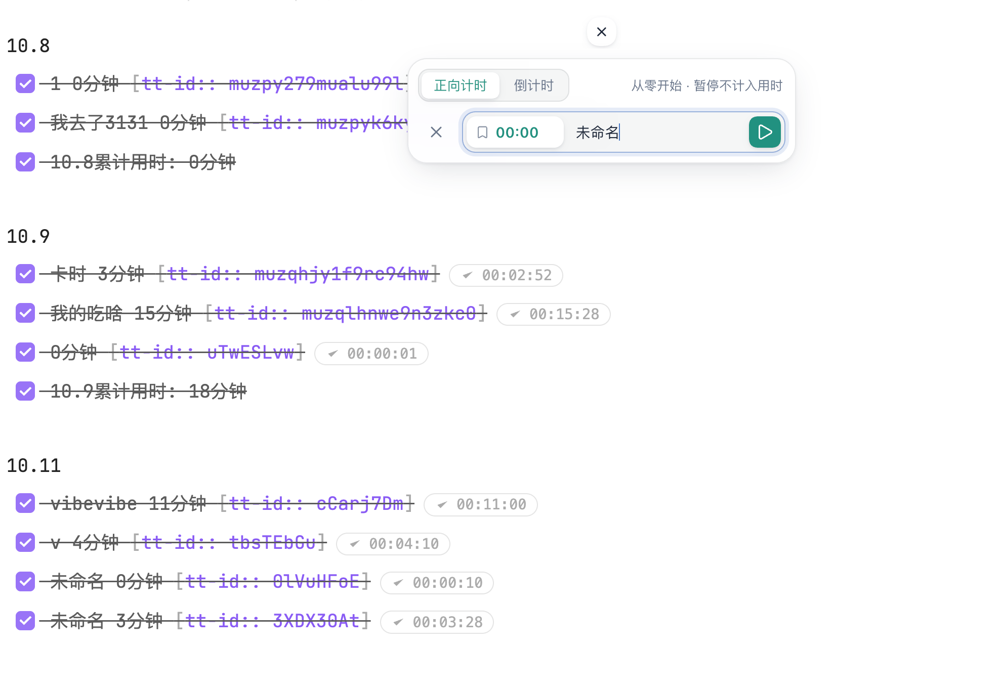

# FluxTimer

English · [中文](README.zh-CN.md)

Compact countdown and stopwatch timers pinned to the top of the active note, with Markdown time logs and a built-in task time tracker. Desktop only.

## Screenshots

| Stopwatch | Countdown with presets |
| --- | --- |
|  |  |

Finished timers are logged to a Markdown note, grouped by date with a daily total:



## Features

- **Countdowns and stopwatches** shown as small rings at the top center of the note. Several countdowns can run at once; stopwatches share a single task tracker.
- **Quick input**: type minutes or `mm:ss` (e.g. `25`, `00:30`) and press Enter, or pick a preset. Presets are configurable (e.g. `Short break=5, Focus=25`, up to 6).
- **Details panel**: click a ring for large remaining/elapsed time, a progress bar and the expected end time. Countdowns can be extended by +1 / +5 minutes or restarted.
- **Finish reminders**: a glass-style card when a countdown ends (+1 / +5 / +30 min, restart), an optional sound, and an optional system notification when Obsidian is in the background.
- **Status bar** shows the next countdown to finish; click it to open that timer.
- **Markdown time log**: named timers are written to a log note as tasks, grouped by date with a daily total:

  ```md
  9.20
  - [x] Math review 250分钟
  - [x] 9.20累计用时: 250分钟
  ```

- **Task time tracking** (bundled [Task Time Tracker](https://github.com/Mythanar/obsidian-task-time-tracker) 0.0.31, MIT): play/stop buttons on task lines, history editing, projects and clients, a statistics dashboard, and CSV / Toggl / Clockify export.
- Horizontal or vertical layout, adjustable size (20–48 px), and light/dark theme support.
- Interface in English or Chinese, following Obsidian's language by default.
- Commands for adding timers, pausing/resuming the latest timer, dismissing reminders, switching layout and opening the log or statistics. No default hotkeys.

## Usage

1. Click **＋** at the top of a note and choose stopwatch or countdown.
2. Give it a name if you want it logged, then start it.
3. Click a ring to pause, resume, extend or finish it. Right-click **＋** to switch layout or open history and statistics.

## Files and privacy

- On first load, FluxTimer creates `提示事项.md` in the vault root as the default log note. Existing files are never overwritten, and you can pick any other note in settings. Only timers with a name are logged.
- Settings and running timers are stored in the plugin's `data.json`. Tracker history is stored in `tracker-data.json` in the plugin folder.
- If the standalone Task Time Tracker plugin has data, it is copied (with a backup) on first load. If that plugin is still enabled, FluxTimer asks you to disable it to avoid double tracking. FluxTimer never disables other plugins itself.
- FluxTimer makes no network requests and does not read or write files outside your vault.

## Installation

From Obsidian: **Settings → Community plugins → Browse**, search for “FluxTimer”.

Manual: download `main.js`, `manifest.json` and `styles.css` from the [latest release](https://github.com/jarrycf/fluxtimer/releases) into `<vault>/.obsidian/plugins/fluxtimer/`, then enable the plugin.

## Development

`main.js` is generated. Edit `main.source.js`, `i18n.cjs` or `tracker-bridge.cjs`, then:

```sh
node build.cjs
node --check main.js
node tests/timer.cjs
node tests/logfile-race.cjs
node tests/browser.cjs   # requires playwright
```

To release, bump `version` in `manifest.json` and `versions.json`, then push a tag with the same version (for example `4.3.0`). GitHub Actions builds the plugin and creates a draft release with `main.js`, `manifest.json` and `styles.css`.

## License

MIT © jarrycf. The bundled Task Time Tracker in `vendor/` is MIT licensed by Mythanar. See `vendor/NOTICE.md`.
